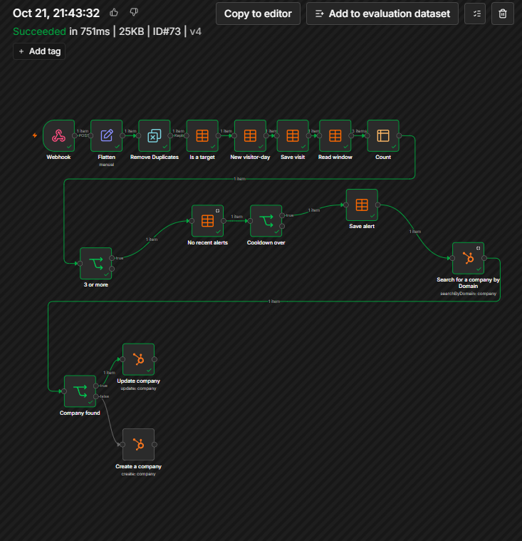
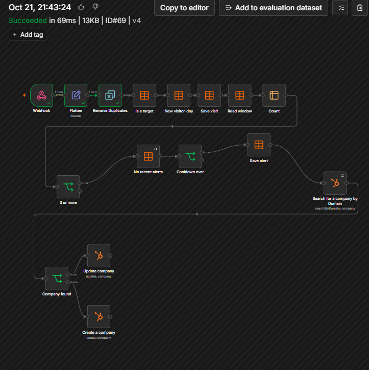
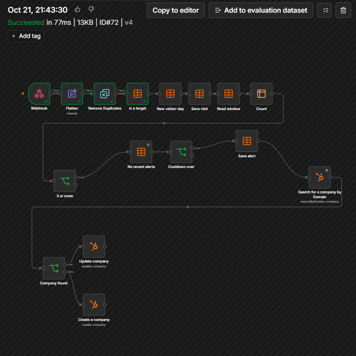
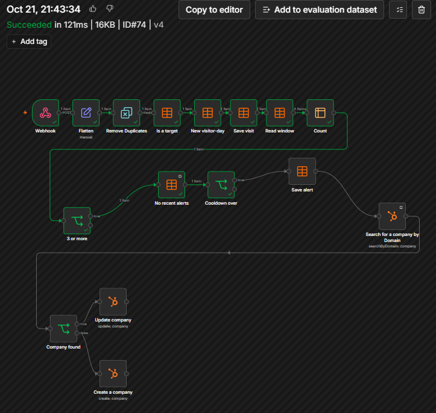
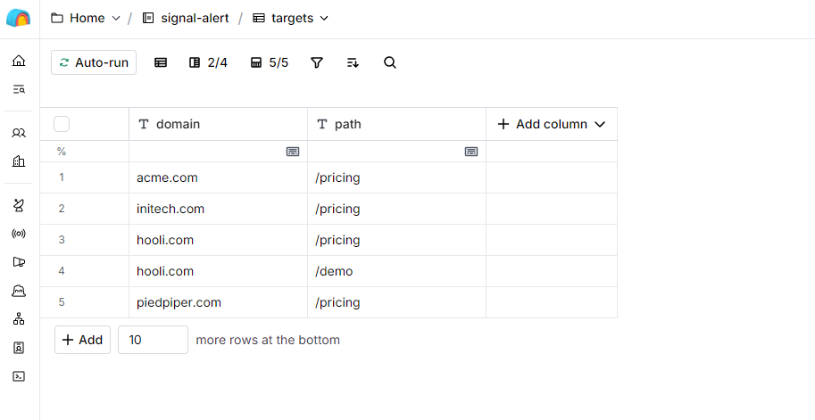
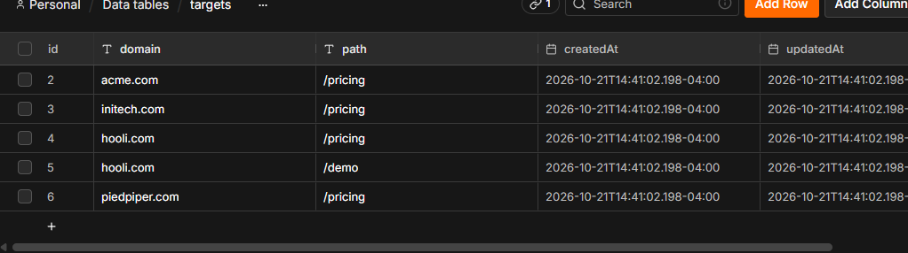
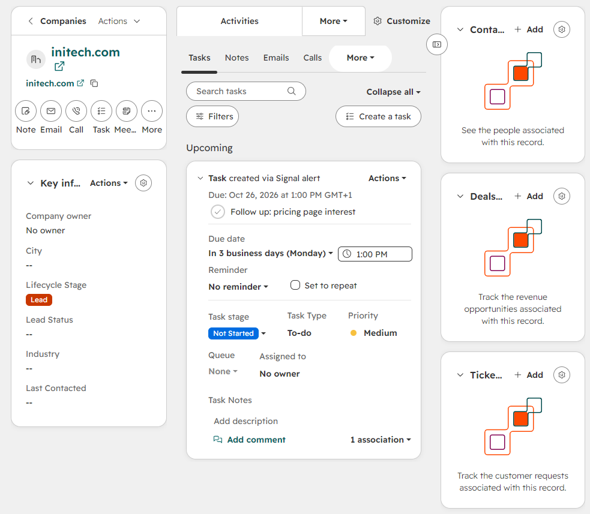
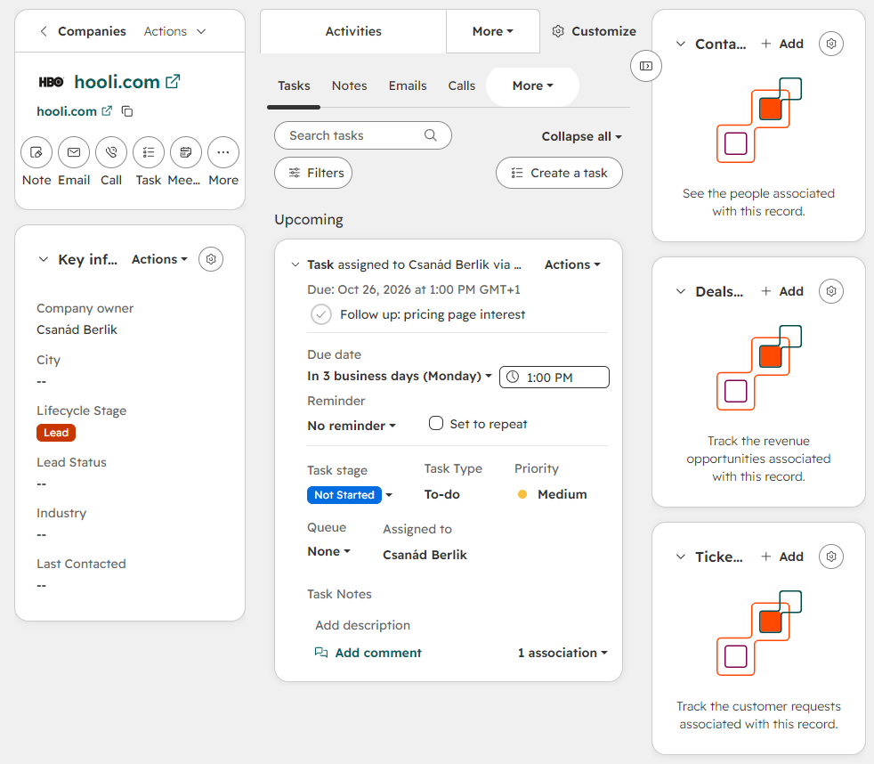

# signal-alert-n8n

An n8n workflow that watches page-view events and, when a target company has 3 distinct visitor-days on a high-intent page within 7 days, writes the count and an alert line onto that company in HubSpot. A HubSpot workflow then creates a follow-up task for the company owner. After an alert the company stays quiet for 7 days.

Built and tested on made-up events against a HubSpot developer test account. There is no real traffic and no client behind it. Everything taken on trust is listed under [Assumptions](#assumptions).

## What is in here

| File | |
|---|---|
| `signal-alert.public.json` | the n8n workflow, with IDs and the webhook path removed |
| `replay.sh` | sends the nine sample events and prints what each should do |
| `demo-second-company.sh` | sends three visitor-days for a second company, to show a new target needs no workflow edit |
| `README.md` | this file |

No secrets are in the repository. The webhook secret and the HubSpot key live in n8n credentials.

## How it works

```
POST /webhook/<path>   header X-Signal-Secret
  wrong secret                       -> 403, no run starts
  Flatten                            event_id, visitor_id, domain, path, day_num
  Remove Duplicates                  event_id already seen        -> stop
  Is a target                        (domain, path) not in the targets table -> stop
  New visitor-day                    same visitor, domain and day already stored -> stop
  Save visit, Read window, Count     rows for this domain in the last 7 days
  3 or more                          fewer than 3                 -> stop
  No recent alerts, Cooldown over    an alert in the last 7 days  -> stop
  Save alert
  Search for a company by Domain     HubSpot, limit 1
  Company found                      yes -> Update company, no -> Create a company
HubSpot workflow: signal_status changed -> create task for the company owner
```

A visitor-day is one `visitor_id` on one UTC day for one domain. The 7-day window is counted from the event's own date, not from the clock: `day_num >= event day_num - 6`. The cooldown uses the same window on the `alerts` table.

n8n answers `200 {"message":"Workflow was started"}` before any of the checks run, so the HTTP code only says the event was received. Open Executions in n8n to see where a run ended. n8n shows a run that was dropped by a check as "Succeeded".

## Set it up

Tested on n8n 2.43.8 in Docker (WSL) and a HubSpot developer test account.

1. **Data tables in n8n.**
   - `visits`: `visitor_id` (text), `domain` (text), `day_num` (number)
   - `alerts`: `domain` (text), `day_num` (number)
   - `targets`: `domain` (text), `path` (text). One row per domain and page to watch, for example `acme.com` and `/pricing`. To watch another company or page, add a row. The workflow does not change.
2. **Credentials in n8n.** Header Auth with header name `X-Signal-Secret` and a secret of your choosing. HubSpot with credential type Service Key.
3. **HubSpot properties on Company.** `pricing_visits_7d` (number) and `signal_status` (single-line text). The service key also needs permission to read owners. Without it the owner dropdown in `Create a company` shows "Error fetching options from HubSpot".
4. **Import** `signal-alert.public.json`. Re-select the credentials and the three data tables on the nodes that show a warning, set a webhook path, and pick the company owner in `Create a company`.
5. **HubSpot workflow.** Company workflow, trigger "One property value changed" on `signal_status`, condition "is known", re-enrollment on. Action: Create task, assigned to the company owner. When turning it on, choose to enrol only records that meet the criteria after it is turned on.
6. **Publish** the n8n workflow. Until it is published the production URL returns 404. The Execute button only runs one manual test.

## Replay

```bash
WEBHOOK_URL=http://localhost:5678/webhook/<path> SIGNAL_SECRET=<secret> bash replay.sh
```

Before each run, empty `visits` and `alerts` but not `targets`. The `targets` table needs one row, `acme.com` and `/pricing`. The script prefixes event IDs with a tag (the time, by default) because Remove Duplicates remembers every ID it has seen.

| # | Event | Expected stop in Executions | HTTP |
|---|---|---|---|
| 1 | Anna, acme.com, /pricing, 9 Oct | `3 or more` (count 1) | 200 |
| 2 | Anna again, same day | `New visitor-day` | 200 |
| 3 | event 1 sent again | `Remove Duplicates` | 200 |
| 4 | Ben, /blog, 10 Oct | `Is a target` | 200 |
| 5 | Ben, /pricing, 11 Oct | `3 or more` (count 2) | 200 |
| 6 | Cara, globex.io, /pricing | `Is a target` | 200 |
| 7 | Dan, /pricing, 12 Oct | through `Update company` or `Create a company` (count 3, alert) | 200 |
| 8 | Eva, /pricing, 13 Oct | `Cooldown over` (count 4, inside the cooldown) | 200 |
| 9 | Nina, wrong secret | no run starts | 403 |

Result, 21 Oct 2026: all nine HTTP codes matched and each of the eight runs stopped at the node in the table. The run that sent event 7 updated the company in HubSpot. The eight runs were repeated on the published workflow (n8n version v4, with the owner set on `Create a company`) and stopped at the same nodes.

## Screenshots

The four flow pictures are from the replay on version v4. The Clay and n8n table pictures and the two HubSpot task pictures are from the setup and the second-company test, all on 21 Oct 2026, on made-up events. Green nodes ran, grey nodes did not.

**Event 7, a full run.** The count reaches 3, the alert is saved, HubSpot is searched, and the company is updated.



**Event 1 sent again.** The run stops at Remove Duplicates.



**A company that is not in the list (globex.io).** The run stops at Is a target.



**Event 8, inside the 7-day cooldown.** The count is 4 and the run stops at Cooldown over.



**The target list in Clay,** five hand-typed rows, and **the same list in n8n,** imported from the Clay export.





**Bug found in testing.** A company the flow created had no owner, so its task was assigned to nobody.



**After the fix.** The flow sets the owner when it creates the company, and the task is assigned to them.



## Choices

- The alert fires at 3 or more, not exactly 3, so a jump from 2 to 4 still alerts.
- Counting is per visitor-day. One person on three days reaches 3, so the alert text says "target-page visitor-days".
- All target pages of one domain count together. One visitor on `/pricing` and `/demo` the same day is one visitor-day.
- State sits in n8n data tables, so the alert decision does not depend on reading HubSpot properties back.
- The target list is a table, not a node setting, so a change is one row.
- A duplicate event returns 200. A retrying sender has done nothing wrong.

## Assumptions

| Assumption | Why | If it's wrong |
|---|---|---|
| All events are made up (acme.com, /pricing, the nine-event table). | No client or real traffic available. | Nothing is proven on real volume or real data quality. |
| Each event already carries the company `domain`. The workflow starts after identification. | Matching a visitor to a company is a separate problem. | Real sources are forms, email links or identification tools, which infer the company and are often wrong. EU privacy rules limit what may be collected. Counts and alerts follow whatever that step gets wrong. |
| Targets are rows in the `targets` table. The five sample rows were typed into a Clay table and imported into n8n as a CSV export. There is no live link between Clay and n8n. | Keeps the demo small. | A change in Clay does nothing until the list is exported and imported again. A live link needs a node that reads Clay or a sync. |
| Alert at 3 visitor-days, 7-day window, 7-day cooldown. | A starting rule that is easy to explain, not tuned on data. | Too low floods sales, too high misses interest. |
| Days are UTC calendar days. | One clock, and a refresh cannot inflate the count. | A visit at 23:30 in Budapest lands on the next UTC day. One person with two `visitor_id` values counts twice. |
| `ts` is ISO 8601 with a timezone. The window is counted from the event's date. | We define the event shape. | Another format breaks `day_num`. A late event counts on its own day, but an alert that has gone out is not revisited. |
| `event_id` is unique and never reused. Events dropped by a check are marked seen too. | Remove Duplicates keys on it. | A reused ID makes a real event vanish. n8n keeps this memory separately from the data tables, so emptying the tables does not clear it. |
| The webhook is protected by one shared header secret over plain HTTP on localhost. | Simplest thing n8n offers. | No signature and no timestamp check. A real deployment needs TLS and a proper secret handover. |
| The HubSpot task is made by a HubSpot workflow, which starts only when `signal_status` changes. | HubSpot's "property value changed" trigger. | An alert that writes identical text makes no task. The text holds the event date and the count, so a repeat inside the cooldown cannot happen, but replaying the same dates a second time makes no new task. |
| Tasks go to the company owner. Companies the flow creates get one fixed owner, picked in the `Create a company` node. | A company with no owner gets a task that is assigned to nobody. This was seen on initech.com before the owner was set, and fixed. | A fixed owner is a shortcut. A real setup routes owners by territory or round robin. A company that already exists in HubSpot with no owner still gets an unassigned task. acme.com and initech.com were assigned by hand in the test account. |
| HubSpot Company properties `pricing_visits_7d` and `signal_status` exist, created by hand. | Created in the developer test account. | The write fails if the internal names differ. |
| The domain search returns one company, and the first is updated. | The node has limit 1. | Two companies with the same domain: only one is updated. Earlier, a wrong check created a duplicate acme.com, so this was fixed and tested. |
| One n8n instance, self-hosted in Docker in WSL, n8n 2.43.8. | Where it was built. | Other versions may name nodes or fields differently. |
| The alert row is saved before the HubSpot write, and a failed write is not retried. | Read from the workflow, not tested. | A failed HubSpot call loses that alert and still starts the cooldown. |

## Limits

- The target filter looks at the exact `domain` and `path`. Subdomains, query strings and trailing slashes are different values.
- No retry or error workflow. If HubSpot is down when an alert fires, nobody is told.
- `Succeeded` in n8n does not mean an alert was sent. Check where the run stopped.
- The sample events carry the domain directly. The identification step is not built.

## License

MIT
